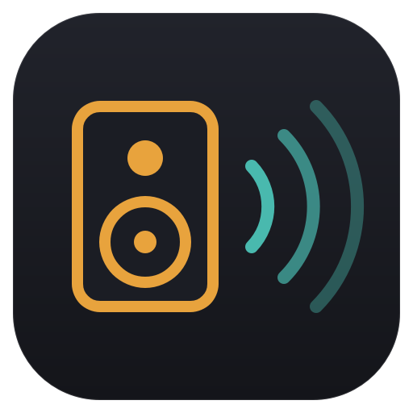
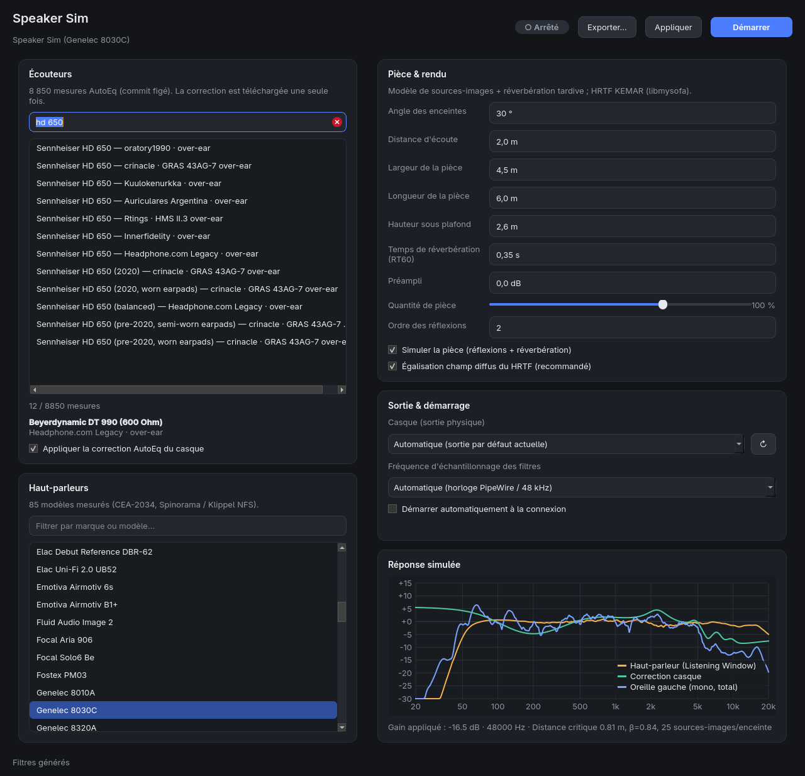

<p align="center"></p>

<h1 align="center">Speaker Sim</h1>

<p align="center"><b>De vraies enceintes, dans une vraie pièce, dans votre casque.</b><br>
<a href="https://devfrp.github.io/SimulSpeaker/">Site</a> ·
<a href="https://github.com/devfrp/SimulSpeaker/releases/latest">Téléchargements</a> ·
<a href="README.md">English version</a></p>

<p align="center"></p>

Speaker Sim transforme une paire d'**enceintes mesurées** en sortie audio virtuelle.
Il combine leur réponse CEA-2034, une **pièce simulée** à partir de vrais matériaux et
d'un traitement acoustique, une **tête KEMAR** (HRTF) et la **correction AutoEq** de
votre modèle de casque. Sous Linux, il fonctionne en direct comme filtre PipeWire. Sous
Windows et macOS, il exporte les filtres pour un convolveur système.

```
Applications ──► [Speaker Sim] (sortie virtuelle, devient la sortie par défaut)
                   │  4 convolutions : enceinte G/D → oreille G/D
                   ▼
                 votre casque (sortie physique)
```

## Installation

| Plateforme | Mode | Comment |
|---|---|---|
| **Linux** | sortie PipeWire virtuelle, en direct | `curl -fsSL https://devfrp.github.io/SimulSpeaker/install.sh \| bash` |
| **Windows** | export → Equalizer APO | [`SpeakerSim-Windows-x64.exe`](https://github.com/devfrp/SimulSpeaker/releases/latest/download/SpeakerSim-Windows-x64.exe) |
| **macOS** | export → convolveur | [Apple Silicon](https://github.com/devfrp/SimulSpeaker/releases/latest/download/SpeakerSim-macOS-AppleSilicon.dmg) · [Intel](https://github.com/devfrp/SimulSpeaker/releases/latest/download/SpeakerSim-macOS-Intel.dmg) |

Le script Linux n'a pas besoin de root. Il installe dans `~/.local/share/devfrp-speaker-sim`
et ajoute la commande `speaker-sim` ainsi qu'une entrée de menu. Options (après `bash -s --`) :
`--uninstall`, `--purge`, `--ref v1.2.0`, `--no-desktop`. Relancez la même commande pour
mettre à jour. Les binaires Windows et macOS ne sont pas signés. Sous Windows : SmartScreen
→ *Informations* → *Exécuter quand même*. Sous macOS : clic droit → *Ouvrir* la première fois.

<details>
<summary>Depuis les sources</summary>

Paquets système (Arch / Omarchy) :

```bash
sudo pacman -S --needed pipewire wireplumber libmysofa python-numpy python-scipy \
    python-requests python-pyqt6
```

Debian/Ubuntu : `sudo apt install pipewire wireplumber libmysofa1 python3-numpy
python3-scipy python3-requests python3-pyqt6`.

Ou dans un environnement virtuel (libmysofa reste un paquet système) :

```bash
cd speaker-sim
python3 -m venv .venv && . .venv/bin/activate
pip install -r requirements.txt
python3 main.py
```

PySide6 fonctionne à la place de PyQt6 (repli automatique, voir `qt_compat.py`).
</details>

## Fonctionnalités

- **Casques** : recherche parmi **8 850** mesures AutoEq (index figé au commit `7ae0f56d`).
  Chaque correction est téléchargée une seule fois, puis gardée en cache.
  **Import de vos mesures** : un EQ AutoEq / Equalizer APO (ParametricEQ, GraphicEQ)
  appliqué tel quel, ou une mesure brute « fréquence, dB » (REW, Squiglink, CSV AutoEq)
  corrigée vers une cible AutoEq (Harman over-ear 2018, Harman in-ear 2019,
  champ diffus ISO 11904-1 ou GRAS KEMAR).
- **Enceintes** : **130** modèles mesurés sur Klippel NFS (ASR, Erin's Audio Corner,
  via Spinorama au commit `acc757bb`), dont **69 moniteurs de studio** (Genelec, Neumann,
  Kali, Adam, JBL, Kii, Focal, Yamaha…). Quand Spinorama n'a que les mesures polaires, les
  courbes CEA-2034 sont calculées localement. Le calcul est identique à celui du logiciel
  Klippel, vérifié sur le KEF R3.
- **Salle** : dimensions, **taux de traitement acoustique** (part des murs couverte de
  panneaux absorbants), pièges à basses, type de murs (maçonnerie / placo), sol (carrelage,
  parquet, tapis, moquette), plafond (plâtre ou nuage acoustique), mobilier, diffusion du
  mur arrière, distance des enceintes au mur avant, hauteur des oreilles. Six préréglages
  sont fournis : salon, studio traité, régie très mate, home-cinéma, chambre, pièce nue.
  Pour aller plus loin : **traitement paroi par paroi** (mur avant, murs latéraux, mur
  arrière, plafond), type d'absorbeur (mousse 5 cm, laine 10 cm, laine 20 cm large bande),
  hauteur des tweeters distincte de celle des oreilles, **place décentrée** (décalage
  latéral), réflexions jusqu'à l'ordre 4, pièces jusqu'à 30 × 20 × 8 m, distance d'écoute
  jusqu'à 10 m, angle jusqu'à 80°, RT60 imposé jusqu'à 4 s.
- **Écoute** : plateaux grave et aigu (105 Hz / 10 kHz), balance gauche/droite, préampli.
- **Interrupteurs** : chaque section de réglages a un interrupteur. Couper *Salle*
  désactive la simulation de la pièce et masque ses réglages. *Réflexions précoces* et
  *Écoute* (tonalité et balance) fonctionnent de la même façon, et *Avancé* affiche ou
  masque les réglages experts. Les réglages forment **une ligne de cartes** sous le plan, répartie en trois onglets
  (salle · placement et réflexions · écoute et avancé). Il n'y a aucun défilement : les
  cartes se partagent la largeur de la fenêtre, et tout tient dans une fenêtre de
  1200 × 730. Le bouton **Réglages** de la barre du haut masque toute la bande.
- **Changements sans coupure** : « Appliquer » démarre une seconde instance (A/B), en fait
  la sortie par défaut, attend que les flux l'aient rejointe, puis arrête l'ancienne. La
  sortie ne disparaît jamais, donc les lecteurs ne se mettent jamais en pause. En mode
  **Auto**, chaque changement est appliqué ainsi de lui-même.
- **États** : démarrage/arrêt, auto-démarrage à la connexion, et **restauration de la
  sortie précédente** à l'arrêt (même si le service est arrêté hors de l'application).
- **Interface** : un **plan de la pièce vu de dessus**, interactif. Traitement, matériaux
  et rayons des premières réflexions y sont dessinés à l'échelle, et vous pouvez déplacer
  l'auditeur ou les enceintes à la souris. Elle affiche aussi la réponse simulée et des
  **vu-mètres RT60 par octave**. L'interface est en **français ou en anglais** : bouton
  FR | EN dans la barre du haut (par défaut, la langue du système). Une **ligne de commande**
  complète est aussi disponible.

## Fonctionnement

Cinq étages sont pré-calculés en quatre réponses impulsionnelles à phase minimale
(enceinte *s* → oreille *e*) :

```
IR[s][e] = HP⁻¹ · ( DF⁻¹ · ( LW · Direct[s][e] + ER · Réflexions[s][e] ) + SP · Réverb[s][e] )
```

1. **Enceinte** : la *Listening Window* filtre le son direct, les *Early Reflections* les
   premières réflexions, la *Sound Power* la réverbération tardive.
2. **Salle** : coefficients d'absorption par bande d'octave (125 Hz–8 kHz) pour chaque
   surface. Le RT60 est calculé par bande (Eyring, avec l'absorption de l'air), ou imposé
   à la main. Un modèle de sources-images (ordre 0–3) calcule les réflexions, chacune
   filtrée par les matériaux de chaque paroi touchée. La réverbération tardive est un bruit
   par octave, décorrélé, avec le RT60 de chaque bande. Son niveau suit la distance
   critique, borné sous la fréquence de Schroeder, où le modèle statistique ne tient plus.
3. **Tête** : chaque arrivée passe par le HRTF MIT KEMAR de sa vraie direction, avec des
   retards fractionnaires exacts et une égalisation champ diffus.
4. **Casque** : l'EQ paramétrique AutoEq devient un IIR, puis une réponse impulsionnelle à
   phase minimale.
5. **Sortie** : les IR sont normalisées pour le pire cas (le même signal sur les deux
   enceintes). Un processus `pipewire -c filter-chain.conf` séparé les exécute, lancé comme
   unité systemd utilisateur transitoire.

## Utilisation

### Interface graphique

```bash
speaker-sim            # ou : python3 speaker-sim/main.py
```

1. **01 Casque** : tapez quelques mots (« hd 650 oratory ») et choisissez votre modèle,
   ou **Importer…** votre propre mesure.
2. **02 Enceintes** : filtre *Studio* / *Hi-Fi*. L'infobulle indique le score Olive, la
   LFX et l'origine de la mesure.
3. **Plan** : faites glisser votre tête (sarcelle) pour vous rapprocher ou reculer, ou une
   enceinte pour changer l'angle et la distance au mur avant.
4. **03 Salle** : choisissez un préréglage, ou réglez traitement, matériaux et dimensions.
   Les vu-mètres RT60 se mettent à jour en direct ; la zone sarcelle (0,2–0,4 s) est la
   cible habituelle de l'écoute critique.
5. Appuyez sur le **bouton d'alimentation**. Avec **Auto** activé, les changements suivants
   s'appliquent d'eux-mêmes, sans coupure.

### Ligne de commande

```bash
speaker-sim --search-headphones "hd 650"
speaker-sim --set-headphone "oratory1990/over-ear/Sennheiser HD 650"
speaker-sim --import-headphone ma-mesure.txt --name "Mon casque" --target "Harman in-ear 2019"
speaker-sim --list-speakers                    # identifiant, studio/hifi, score
speaker-sim --set-speaker "Neumann KH 150" --start
speaker-sim --status
speaker-sim --stop                             # restaure votre sortie précédente
speaker-sim --autostart on                     # ou off
speaker-sim --export ~/irs                     # filtres portables (WAV, true stereo, Equalizer APO)
```

### Windows / macOS (mode export)

**Exporter** (ou `--export DOSSIER`) écrit :

- `ir_LL/LR/RL/RR.wav` et `speaker-sim-true-stereo.wav` (4 canaux : LL, LR, RL, RR) ;
- `speaker-sim.txt` pour **Equalizer APO ≥ 1.2** : copiez le dossier dans
  `C:\Program Files\EqualizerAPO\config\` et ajoutez `Include: speaker-sim.txt` à `config.txt`.

Sur ces systèmes, un lecteur SOFA en Python (h5py) remplace libmysofa.

## Fichiers

Tout s'exécute en tant qu'utilisateur. Sous Linux, l'application n'écrit que dans :

| Emplacement | Contenu |
|---|---|
| `~/.local/state/devfrp-speaker-sim/config.json` | réglages |
| `~/.local/state/devfrp-speaker-sim/runtime.json` | sortie précédente, instance active |
| `~/.local/state/devfrp-speaker-sim/filters/{a,b}/` | IR + `filter-chain.conf` par instance |
| `~/.local/state/devfrp-speaker-sim/imports/` | mesures et EQ de casques importés |
| `~/.local/state/devfrp-speaker-sim/devfrp-speaker-sim-py-a.service` | unité (auto-démarrage) |
| `~/.cache/devfrp-speaker-sim/` | données AutoEq, Spinorama et KEMAR (commits figés) |

`XDG_STATE_HOME` / `XDG_CACHE_HOME` sont respectés. Windows utilise
`%LOCALAPPDATA%\devfrp-speaker-sim` ; macOS utilise `~/Library/Application Support` et
`~/Library/Caches`.

**Aucune configuration de PipeWire, WirePlumber ou Omarchy n'est modifiée.** La seule
interaction avec WirePlumber est le choix de la sortie par défaut (`wpctl set-default`),
comme depuis le menu du volume. L'**auto-démarrage** écrit l'unité dans le dossier d'état
et la déclare à systemd par `systemctl --user link` + `enable`. systemd crée alors des
liens symboliques dans `~/.config/systemd/user/` (son seul moyen de connaître une unité à
la connexion) ; désactiver l'option les supprime.

## Dépôt

```
speaker-sim/            application Python (voir speaker-sim/README.md)
install.sh              installation Linux (curl | bash)
docs/                   site GitHub Pages
.github/workflows/      CI (tests), Release (.exe / .dmg), Site (Pages)
```

Publier une version : `git tag vX.Y.Z && git push origin vX.Y.Z`. GitHub Actions construit
l'exe Windows et les apps macOS, et teste chaque binaire en exportant de vrais filtres.
Il crée ensuite la release avec les sommes SHA-256.

Lancer les tests : `cd speaker-sim && python3 -m unittest discover -s tests -t .`. Ils
n'ont besoin ni du réseau, ni de PipeWire, ni de systemd (tous simulés).

## Dépannage

- **« libmysofa introuvable »** : installez `libmysofa`, ou laissez l'application passer
  par h5py (l'installateur l'ajoute si besoin).
- **Le service s'arrête aussitôt** : `journalctl --user -u 'devfrp-speaker-sim-py*' -n 50`.
- **Pas de son** : `wpctl status` doit montrer *Speaker Sim* comme sortie par défaut et
  `devfrp_speaker_sim_py_a.output` (ou `_b`) relié au casque.
- **Volume faible** : les filtres gardent de la marge pour le pire cas. Montez le
  *Préampli*, en surveillant l'écrêtage dans les basses.
- **Hors ligne** : seules les données déjà en cache sont utilisables.

## Licence

MIT © 2026 devfrp. Données : AutoEq (MIT, Jaakko Pasanen), Spinorama (GPL-3.0,
Pierre Aubert) avec les mesures Klippel d'ASR / Erin's Audio Corner, MIT KEMAR (Gardner &
Martin, MIT Media Lab). Les données sont téléchargées à la demande, jamais redistribuées.
Polices : Space Grotesk, Inter, JetBrains Mono (SIL Open Font License, voir
`speaker-sim/packaging/fonts`).
